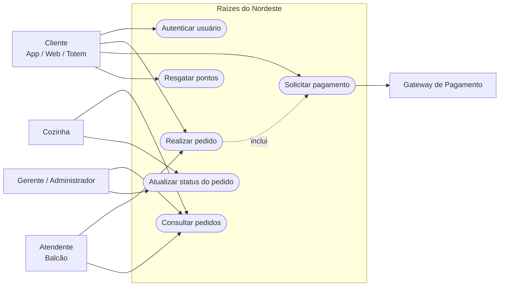

# Diagrama de Casos de Uso

## Fluxo crítico

O fluxo crítico do sistema é composto pelos casos de uso **Realizar Pedido** e **Solicitar Pagamento**.

Ao realizar um pedido, o sistema valida a unidade, os itens, o cardápio, os valores e a disponibilidade de estoque. Havendo disponibilidade, o estoque é reservado e o pedido permanece aguardando pagamento.

Na solicitação de pagamento, o gateway simulado retorna um resultado de aprovação, recusa ou falha. Em caso de aprovação, a reserva de estoque é convertida em saída confirmada e o pedido segue para preparação. Em caso de recusa ou falha, as reservas associadas são liberadas.

As associações apresentadas no diagrama destacam as responsabilidades principais de cada ator. As permissões completas por perfil são aplicadas pela camada de segurança da API e podem incluir operações adicionais conforme as regras de autorização dos endpoints.

A autenticação é requisito comum aos atores humanos que acessam operações protegidas da API. Para preservar a legibilidade do diagrama, a associação com o caso de uso "Autenticar usuário" foi representada apenas de forma ilustrativa.