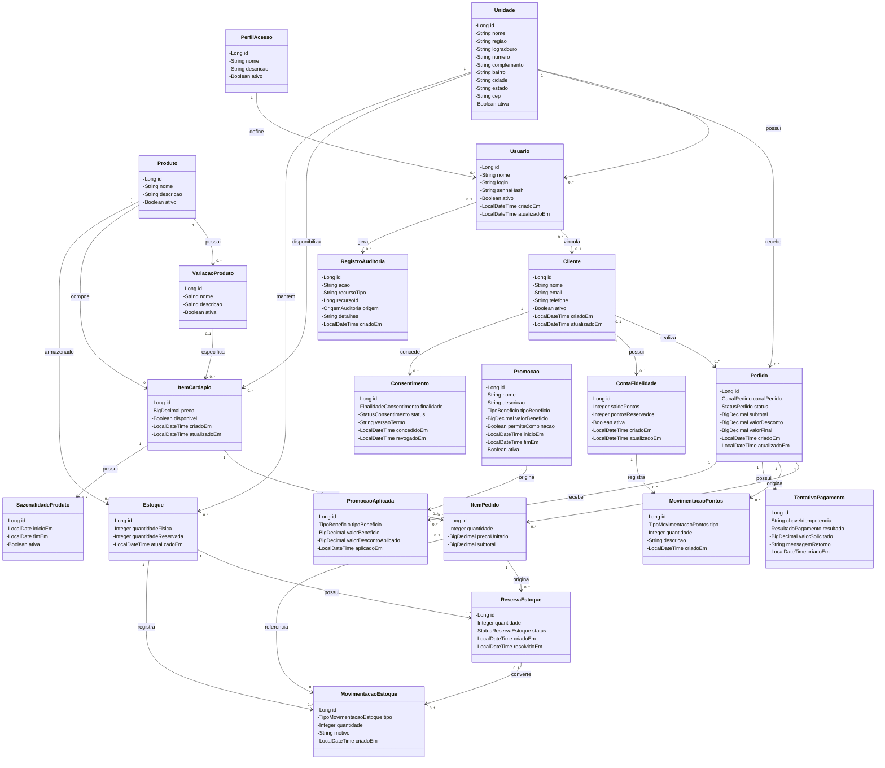

# Diagrama de Classes

O diagrama representa as principais classes do domínio da aplicação Raízes do Nordeste, seus atributos e relacionamentos.

Getters, setters e demais métodos triviais foram omitidos para manter a legibilidade.

## Observações

O diagrama representa as classes da camada `domain.model`. As classes de persistência JPA, DTOs, controllers, casos de uso, adapters e configurações pertencem a outras camadas da arquitetura e não são duplicadas neste diagrama.

Os tipos `CanalPedido`, `StatusPedido`, `StatusReservaEstoque`, `TipoMovimentacaoEstoque`, `TipoMovimentacaoPontos`, `ResultadoPagamento`, `TipoBeneficio`, `FinalidadeConsentimento`, `StatusConsentimento` e `OrigemAuditoria` são enums do domínio.

Os campos de controle de concorrência otimista `version`, presentes nas tabelas `estoque` e `conta_fidelidade`, pertencem ao mapeamento de persistência e por isso aparecem no DER, mas não nas classes de domínio acima.