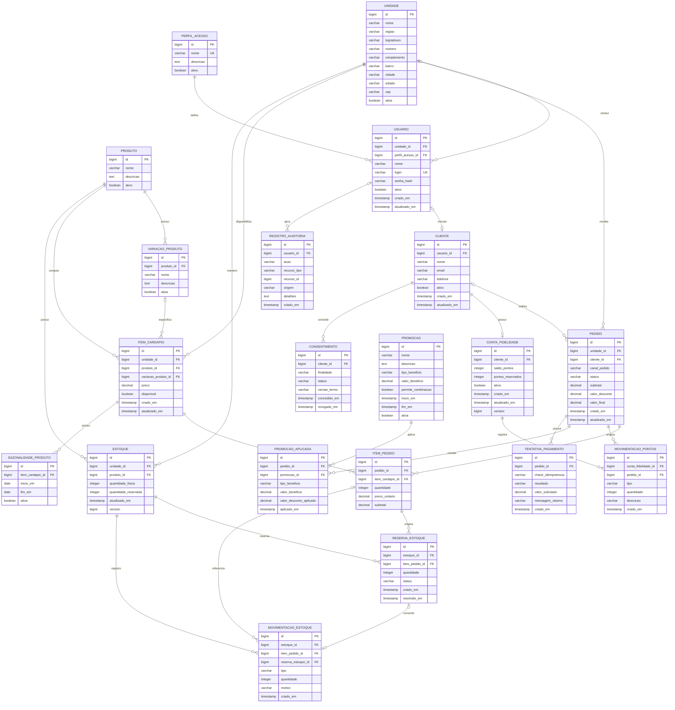

# Diagrama Entidade-Relacionamento — DER


O banco de dados da aplicação utiliza PostgreSQL e é versionado por migrations Flyway.


O modelo atual possui 20 tabelas. O diagrama abaixo representa as entidades persistidas, suas chaves primárias e estrangeiras e os principais relacionamentos.





## Restrições relevantes


Além das chaves primárias e estrangeiras representadas no DER, o banco possui restrições adicionais importantes para preservar a integridade das regras de negócio.


- `perfil_acesso.nome` é único.

- `usuario.login` é único.

- `cliente.usuario_id` é único, permitindo no máximo um cliente associado a cada usuário.

- A combinação `estoque(unidade_id, produto_id)` é única.

- `movimentacao_estoque.reserva_estoque_id` é único quando informado.

- `conta_fidelidade.cliente_id` é único, permitindo no máximo uma conta de fidelidade por cliente.

- A combinação `item_cardapio(unidade_id, produto_id, variacao_produto_id)` é única, incluindo valores nulos de variação.

- Pode existir apenas um consentimento com status `ATIVO` para a mesma combinação de cliente e finalidade.

- Pode existir apenas uma movimentação de pontos do tipo `CREDITO` para cada pedido.

- A combinação `tentativa_pagamento(pedido_id, chave_idempotencia)` é única, garantindo suporte à idempotência do processamento de pagamentos.


## Concorrência otimista


As tabelas `estoque` e `conta_fidelidade` possuem o campo:


```text

version BIGINT NOT NULL DEFAULT 0

```


Esse campo é utilizado para controle de concorrência otimista, evitando sobrescritas silenciosas em operações concorrentes envolvendo estoque e saldo de fidelidade.