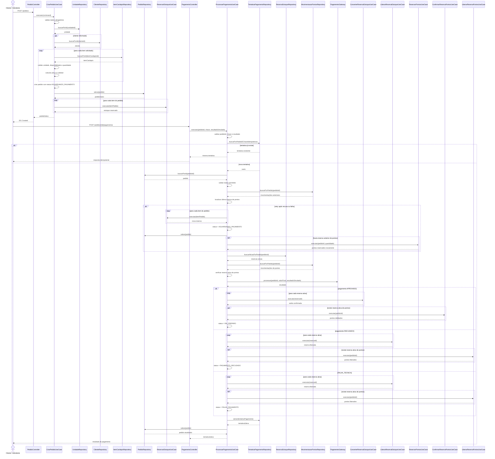

# Diagrama de Sequência — Pedido e Pagamento

O diagrama abaixo representa o fluxo crítico da aplicação, desde a criação do pedido até o processamento do pagamento, incluindo idempotência, novas tentativas de pagamento, estoque e fidelidade.

## Regras representadas

O fluxo demonstra que o pedido é salvo inicialmente com status `AGUARDANDO_PAGAMENTO` e que o estoque é reservado antes do processamento financeiro.

A chave de idempotência é consultada antes de qualquer novo processamento. Se uma tentativa com a mesma combinação de pedido e chave já existir, a tentativa anterior é retornada sem repetir os efeitos de estoque, pontos ou pagamento.

Novas tentativas são permitidas apenas quando o pedido está em `AGUARDANDO_PAGAMENTO`, `PAGAMENTO_RECUSADO` ou `FALHA_PAGAMENTO`.

Em um retry após recusa ou falha, o sistema reserva novamente o estoque dos itens e, quando aplicável, recria a reserva de pontos de fidelidade antes de chamar o gateway.

Quando o pagamento é aprovado, as reservas de estoque são convertidas em saídas confirmadas, a reserva de pontos é confirmada quando existente e o pedido avança para `EM_PREPARO`.

Quando o pagamento é recusado ou ocorre falha técnica, as reservas de estoque e de pontos são liberadas e o pedido assume respectivamente `PAGAMENTO_RECUSADO` ou `FALHA_PAGAMENTO`.
